```mermaid
graph LR
    A[🐧 Linux + Networking] --> B[🐍 Python Scripting]
    B --> C[🌐 Web App Security]
    C --> D[⚔️ Pentesting & CTFs]
    D --> E[🛡️ Blue Team / SOC]
    E --> F[☁️ Cloud Security]
    F --> G[🏆 Cybersecurity Engineer]
    style A fill:#000,stroke:#00ff41,color:#00ff41
    style B fill:#000,stroke:#00ff41,color:#00ff41
    style C fill:#000,stroke:#00ff41,color:#00ff41
    style D fill:#000,stroke:#ff0040,color:#ff0040
    style E fill:#000,stroke:#0099ff,color:#0099ff
    style F fill:#000,stroke:#0099ff,color:#0099ff
    style G fill:#00ff41,stroke:#00ff41,color:#000
```

<!-- ═══════════════ HEADER ═══════════════ -->


<div align="center">

[](https://git.io/typing-svg)


</div>

---

## 🖥️ `$ cat about_me.txt`

```bash
┌──(bisheswar㉿kali)-[~]
└─$ cat about_me.txt

[+] Name        : Bisheswar Bhattacharjee
[+] Role        : Cybersecurity Engineer (in progress)
[+] Location    : India 🇮🇳
[+] Focus       : Web App Security • Network Security • Offensive Security
[+] Weapon      : Python + Kali Linux + Curiosity
[+] Mission     : Think like an attacker, defend like an engineer
[+] Status      : [████████████████░░░░] Learning 24/7
[+] Motto       : "Every system has a weakness. I'm learning to find it."
```

---

## 🧠 `$ ./skills --all`

### 🔴 Offensive Security (Red Team)


### 🔵 Defensive Security (Blue Team)


### 🟣 Core Foundations


---

## ⚔️ `$ ls /opt/arsenal`

<div align="center">

| 🛠️ Category | ⚡ Tools |
|:---:|:---|
| **🔍 Recon & Scanning** | `Nmap` • `Masscan` • `Netcat` • `theHarvester` • `Amass` • `Sublist3r` • `Shodan` • `Maltego` |
| **🌐 Web Security** | `Burp Suite` • `OWASP ZAP` • `SQLmap` • `Gobuster` • `Dirb` • `ffuf` • `Nikto` • `WPScan` |
| **🔓 Exploitation** | `Metasploit` • `Searchsploit` • `Exploit-DB` • `Netcat Shells` • `msfvenom` |
| **🔑 Password Attacks** | `Hydra` • `John the Ripper` • `Hashcat` • `CeWL` • `Crunch` |
| **📡 Network & Sniffing** | `Wireshark` • `tcpdump` • `Scapy` • `Ettercap` • `Aircrack-ng` |
| **🕵️ Forensics & RE** | `Autopsy` • `Volatility` • `Ghidra` • `Binwalk` • `Strings` • `ExifTool` |
| **🛡️ Defense & Monitoring** | `Snort` • `Fail2Ban` • `UFW / iptables` • `Splunk` • `ELK Stack` • `Suricata` |
| **🧪 Labs & Practice** | `TryHackMe` • `Hack The Box` • `PicoCTF` • `DVWA` • `Juice Shop` • `VulnHub` |
| **🐧 OS & Virtualization** | `Kali Linux` • `Parrot OS` • `Ubuntu` • `VirtualBox` • `VMware` • `Docker` |

</div>

---

## 🐍 `$ python3 build_tools.py`

<div align="center">

[](https://skillicons.dev)

</div>

```python
class CyberEngineer:
    def __init__(self):
        self.name     = "Bisheswar Bhattacharjee"
        self.os       = ["Kali Linux", "Ubuntu", "Windows"]
        self.language = ["Python", "Bash", "HTML/CSS", "SQL"]
        self.mindset  = "Think like an attacker. Defend like an engineer."
        self.learning = ["Web App Pentesting", "Linux PrivEsc",
                         "Network Security", "Malware Analysis (basics)",
                         "Cloud Security", "SOC Operations"]

    def daily_routine(self):
        while True:
            self.learn()
            self.hack_in_labs()
            self.build_tools()
            self.document_everything()
            # repeat 🔁

me = CyberEngineer()
me.daily_routine()
```

---

## 🚀 `$ ./featured_projects --list`

<div align="center">

| 🎯 Project | 📝 Description | 🛠️ Stack |
|:---|:---|:---:|
| [**🔍 Advanced Port Scanner**](https://github.com/Bisheswar-94/Python-Advanced-Port-Scanner) | Multithreaded scanner with service detection, banner grabbing & domain resolution | `Python` `Sockets` `Threading` |
| [**📡 Packet Sniffer**](https://github.com/Bisheswar-94/Python-Simple-Packet-Sniffer) | Captures live packets and shows source IP, destination IP & protocol in real time | `Python` `Scapy` |
| [**🚨 Brute Force Detector**](https://github.com/Bisheswar-94/Python-Login-Brute-Force-Detector) | Detects repeated failed logins, flags brute-force behavior & logs malicious IPs | `Python` `Log Analysis` |
| [**🌐 Cybersecurity Portfolio V2.0**](https://github.com/Bisheswar-94/CyberSecurity-PortfolioV2.0) | My personal cybersecurity portfolio website — [**live demo**](https://bisheswar-94.github.io/CyberSecurity-PortfolioV2.0/) | `HTML` `CSS` `JS` |

</div>

---

## 📡 `$ cat current_missions.log`

```diff
+ [ACTIVE]   Web Application Security (OWASP Top 10, Burp Suite traffic analysis)
+ [ACTIVE]   Network Enumeration & Recon workflows
+ [ACTIVE]   Linux Privilege Escalation techniques
+ [ACTIVE]   Python Security Tool Development
+ [BUILDING] Banner Grabber  |  WHOIS + DNS Tool  |  Subdomain Scanner  |  Directory Scanner
! [NEXT]     Active Directory Attacks & Windows Security
! [NEXT]     Cloud Security (AWS / Azure fundamentals)
! [NEXT]     SIEM / SOC Analyst workflows
! [NEXT]     Malware Analysis & Reverse Engineering basics
- [GOAL]     Certifications → CEH • eJPT • Security+ • OSCP
```

---

## 🗺️ `$ ./roadmap --visualize`

```text
 Learning Distribution
 ───────────────────────────────────────────────
 Python Security Tools  ████████████████░░░░  35%
 Linux & Privilege Esc  ██████████░░░░░░░░░░  20%
 Web App Security       ██████████░░░░░░░░░░  20%
 Networking             ████████░░░░░░░░░░░░  15%
 CTF Practice           █████░░░░░░░░░░░░░░░  10%
 ───────────────────────────────────────────────
```



---

## 📊 `$ ./stats --github`

<div align="center">


</div>

---

## 🐍 `$ ./contribution_snake`

<div align="center">


</div>

---

## 🧩 `$ ./ctf_and_labs --status`

<div align="center">

[](https://tryhackme.com)
[](https://www.hackthebox.com)
[](https://picoctf.org)
[](https://owasp.org)

</div>

---

## 🧬 `$ ./philosophy`

```text
  ╔════════════════════════════════════════════════════╗
  ║  "Security is not a product, it's a process."      ║
  ║                                                    ║
  ║   ▸ Learn  →  Break (legally)  →  Fix  →  Share   ║
  ║   ▸ Always hack with permission. Always stay ethical.║
  ╚════════════════════════════════════════════════════╝
```

> ⚠️ **Disclaimer:** All my tools and projects are built for **educational purposes and authorized testing only**. I follow ethical hacking principles and responsible disclosure.

---

## 📬 `$ ./contact --connect`

<div align="center">

[](https://www.linkedin.com/in/bisheswar-bhattacharjee-4810a1337)
[](https://www.instagram.com/shive__03/)
[](https://bisheswar-94.github.io/CyberSecurity-PortfolioV2.0/)
[](mailto:YOUR_EMAIL@gmail.com)

<br/>

```bash
┌──(bisheswar㉿kali)-[~]
└─$ echo "Let's secure the digital world together 🔐"
Let's secure the digital world together 🔐
└─$ _
```

</div>


